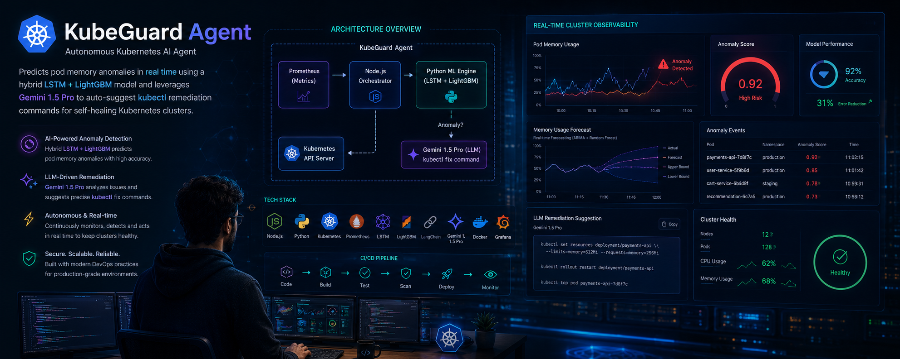
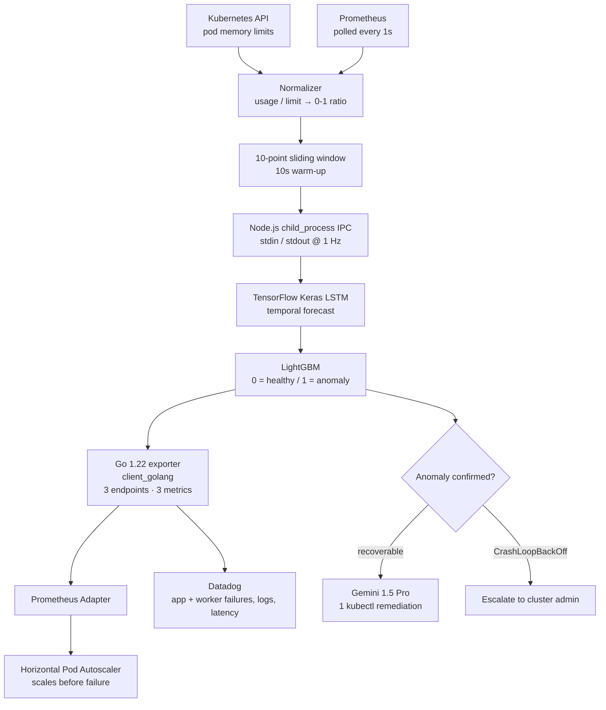
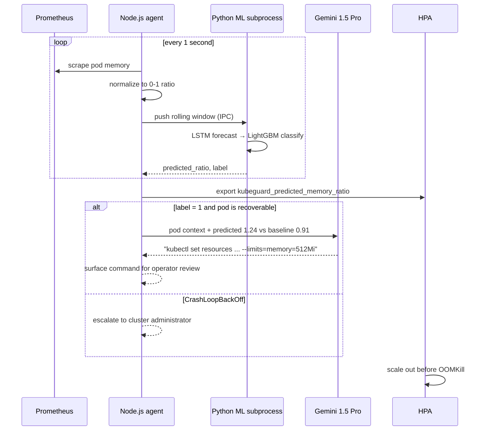

# 🛡️ KubeGuard — Autonomous Kubernetes AI Monitoring Agent



> **Predict pod memory anomalies before they become OOMKills — then let an LLM write the fix.**

[](https://nodejs.org/)
[](https://python.org/)
[](https://golang.org/)
[](https://kubernetes.io/)
[](https://prometheus.io/)
[](https://tensorflow.org/)
[](https://ai.google.dev/)

---

## Highlights

- Developed a Kubernetes monitor that polls **Prometheus every 1 second** and uses an **LSTM** forecast plus a **LightGBM** classifier to flag pod memory anomalies *before* limits are breached, benchmarked against **2 traditional approaches**: threshold alerts and Prometheus alerting rules.
- Normalized every sample against the pod's configured memory limit pulled from the Kubernetes API, turning raw usage into a portable **0–1 memory ratio** that generalizes across pods.
- Maintained a **10-point sliding window** of memory ratios feeding the LSTM, delaying predictions until a **10-second warm-up** fills the window so inference never runs on an incomplete series.
- Separated forecasting from classification with a **2-model hybrid**: TensorFlow Keras LSTM for temporal prediction, LightGBM for binary classification (**0** healthy, **1** anomaly).
- Chose persistent Node.js `child_process` **IPC over REST**, streaming the **1 Hz** rolling window to a Python subprocess through stdin/stdout so high-frequency inference does not pay HTTP overhead.
- Built a **Go 1.22** exporter with `client_golang` exposing **3 endpoints** and **3 custom metrics**, routing `kubeguard_predicted_memory_ratio` to the **Horizontal Pod Autoscaler** through Prometheus Adapter so workloads scale out *before* memory failure.
- Invoked **Gemini 1.5 Pro** only after a confirmed anomaly, generating **1 targeted `kubectl` remediation command** from live pod context — for example setting memory to **512Mi** for a predicted ratio of **1.24** against a healthy baseline of **0.91**.
- Split remediation into **2 triage paths**: recoverable anomalies get LLM-suggested fixes, while `CrashLoopBackOff` cases escalate to a cluster administrator instead of auto-remediating an already-failing pod.
- Added a complementary **Datadog** integration for API and background-worker failure visibility, structured logs and latency alerting — Prometheus stays the source for the memory-ratio and autoscaling pipeline.

---

## Architecture



## Detection to remediation



---

## Why predictive, not reactive

| Approach | When it fires |
|---|---|
| Static threshold alerts | **After** usage crosses the line |
| Prometheus alerting rules | **After** the rule window elapses |
| **KubeGuard** | **Before** the limit is breached — LSTM forecast + LightGBM classification on a 1 Hz window |

## Exported metrics

| Metric | Used by |
|---|---|
| `kubeguard_predicted_memory_ratio` | Prometheus Adapter → HPA |
| `kubeguard_anomaly_score` | Dashboards and alerting |
| `kubeguard_inference_latency_seconds` | Agent health |

## Tech stack

**Cluster** Kubernetes API · kubectl proxy · HPA · Prometheus Adapter · Deployment/Service YAML
**Metrics** Prometheus · PromQL · Datadog
**Exporter** Go 1.22 · `client_golang`
**Agent** Node.js 20 · Express · subprocess IPC
**ML** Python · TensorFlow/Keras LSTM · LightGBM · NumPy
**LLM** LangChain · Google Gemini 1.5 Pro
**Packaging** Docker multi-stage builds

## Quick start

```bash
git clone https://github.com/Brijesh03032001/KubeGuard.git
cd KubeGuard
```

```bash
kubectl apply -f k8s/        # exporter, agent deployment, service, HPA
```

```bash
cp .env.example .env         # PROMETHEUS_URL, GEMINI_API_KEY, DATADOG_API_KEY
npm install && npm start
```

---

**Built by [Brijesh Kumar](https://github.com/Brijesh03032001)** · [Portfolio](https://brijeshbuilds.com) · [LinkedIn](https://linkedin.com/in/brijeshkumar03)
